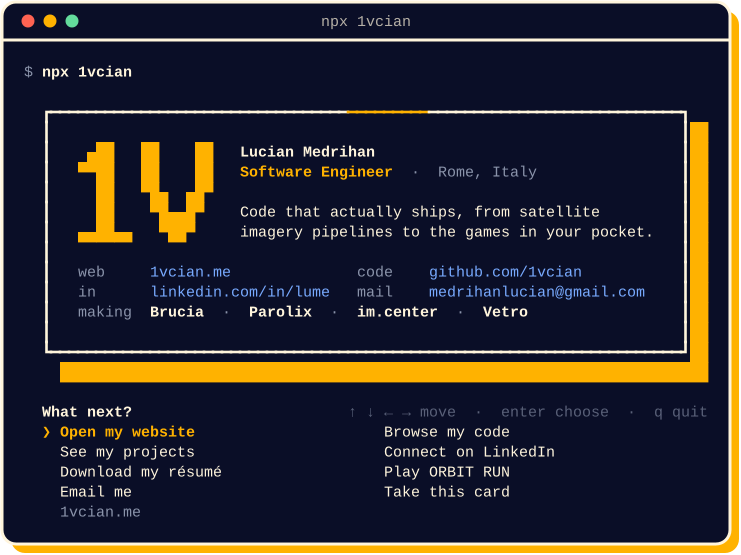
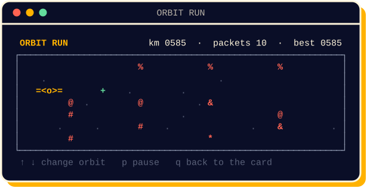

# 1vcian

My business card. It lives in your terminal:

```sh
npx 1vcian
```

<p align="center">
  
</p>

Nothing to install, and nothing to download but the card itself: it has **zero dependencies**.
It makes no network requests either. A link opens only when you pick it.

## What's in it

- **The card.** Who I am, what I'm making, where to find me. Links are clickable in terminals that support it.
- **A menu.** Website, email, résumé, GitHub, LinkedIn: arrows and enter.
- **Good manners.** Colours adapt to the terminal (true colour, 256, 16, or none), `NO_COLOR` is respected, piped output is plain text, narrow windows get a compact layout.
- **A game.** Hidden. The card tells you where to look.

<details>
<summary>Spoiler: the game</summary>

<br>

On the menu, type the Konami code: <kbd>↑</kbd> <kbd>↑</kbd> <kbd>↓</kbd> <kbd>↓</kbd> <kbd>←</kbd> <kbd>→</kbd> <kbd>←</kbd> <kbd>→</kbd> <kbd>b</kbd> <kbd>a</kbd>. Or skip the ceremony with `npx 1vcian --play`.

<p align="center">
  
</p>

**ORBIT RUN.** You fly a satellite along seven orbit lanes. Debris comes in waves, every packet `+` you catch is worth 25 km, and the whole thing speeds up as you go.

It is fair: every wave leaves at least two lanes open, and one of them is never more than one step away from a lane the previous wave left open. There is a test for that, and an autopilot that flies 5,000 ticks at full speed without a scratch.

`--seed 42` gives you the same debris field every time, if you want to race a friend.

</details>

## Options

| command | what you get |
| --- | --- |
| `npx 1vcian` | the card, with the menu |
| `npx 1vcian --static` | the card and nothing else |
| `npx 1vcian --json` | the same facts, for scripts |
| `npx 1vcian --plain` | no colours |
| `npx 1vcian --ascii` | no box-drawing or block characters |
| `npx 1vcian --help` | all of the above |

Needs Node.js 18 or newer.

## Make it yours

It is MIT licensed and everything personal sits in one file, so take it.

1. Fork or clone this repo.
2. Edit [`lib/profile.js`](lib/profile.js): name, links, menu, even the logo.
3. In `package.json`, change `name` (it is what people will type after `npx`), `bin`, `author` and the URLs, and reset `version`.
4. Try it with `node card.js`, check it with `npm test`.
5. Redraw the pictures in this README with `npm run preview`.
6. `npm login`, then `npm publish`.

## How it is made

| file | what it does |
| --- | --- |
| [`card.js`](card.js) | the command: options, the menu, the way into the game |
| [`lib/profile.js`](lib/profile.js) | the content |
| [`lib/render.js`](lib/render.js) | lays out the card and the menu |
| [`lib/term.js`](lib/term.js) | what the terminal can do: colour depth, the box, keys, opening links |
| [`lib/game.js`](lib/game.js) | the game: the rules as plain functions, then the part that draws them |
| [`scripts/preview.mjs`](scripts/preview.mjs) | turns the real output into the SVG pictures above |
| [`test/`](test) | `node --test`, no test framework either |

## License

[MIT](LICENSE) © [Lucian Medrihan](https://1vcian.me)
